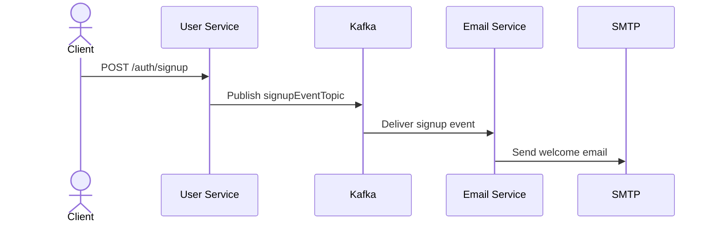

# 🛒 E-Commerce Application

A Spring Boot microservices backend for managing users, product catalogs, carts, orders, payments, and signup emails.

**Stack:** Java 17/21 · Spring Boot · Spring Cloud · MySQL · Redis · Apache Kafka · Razorpay

## ✨ What the project does

- 🔐 **User accounts:** Signup, login, JWT validation, and role management.
- 📦 **Product catalog:** Product and category management, filtering, and paginated search.
- 🛍️ **Cart and orders:** Add items to a cart, update quantities, and place orders.
- 💳 **Payments:** Create Razorpay payment links through the Payment Service.
- 📧 **Signup emails:** Publish signup events to Kafka and send welcome emails through an independent Email Service.

## 🏗️ Services

| Module | Responsibility | Local port |
| --- | --- | --- |
| `ApiGateway` | Routes user and catalog requests to services discovered through Eureka | `8080` by default |
| `ServiceDiscovery` | Eureka service registry | `8761` |
| `ConfigurationServer` | Centralized configuration backed by Git, with a Flyway migration for its MySQL schema | `8085` |
| `EcommerceUserService` | Authentication, roles, and signup event publishing | `8081` in the configured JWT issuer |
| `ECommerceProductService/ECommerceProductService` | Product and category APIs, search, and Redis integration | `8082` |
| `EcommerceOrderService` | Cart management and order placement | `8083` |
| `EcommercePaymentService` | Razorpay payment link creation | `8084` |
| `EmailService` | Consumes signup events and sends emails over SMTP | `9000` |

### 📧 Signup email flow



The Product Service also includes a **Fake Store API client**. The main product controller uses the local product service.

## 🚀 Run locally

1. Install **JDK 21**, Git, MySQL, Kafka, and Redis. The Order and Payment modules target Java 17. Each module includes a Maven Wrapper.

2. Clone the repository.

   ```bash
   git clone https://github.com/ChetanChandrol/Ecommerce-Application.git
   cd Ecommerce-Application
   ```

3. Create the MySQL schemas for the modules you plan to run. Configure each module's datasource URL, username, and password.

4. Configure the Config Server's Git repository and credentials. Supply the User Service's signing keystore and configure its path, password, and alias. Make sure the User Service port and the JWT issuer URL used by the other services agree.

5. Start Kafka and Redis. Configure the Kafka broker and SMTP credentials for signup emails. Use Razorpay test credentials for local payment testing. Keep credentials and private keystores in local configuration.

6. Start Eureka and the Config Server first. Then start the User, Product, Payment, Order, and Email services you need. Start the API Gateway once its target services have registered. Run each module in a separate terminal from the folder containing its `pom.xml`.

   **Windows PowerShell**

   ```powershell
   .\mvnw.cmd spring-boot:run
   ```

   **macOS / Linux**

   ```bash
   ./mvnw spring-boot:run
   ```

The Eureka dashboard is available at `http://localhost:8761`.

## 🔗 API quick reference

| Service | Method and path | Purpose |
| --- | --- | --- |
| User | `POST /auth/signup`, `POST /auth/login` | Register or sign in |
| User | `GET /auth/validate`, `PUT /auth/logout` | Validate or invalidate a token |
| Product | `GET /product`, `GET /product/{id}` | Browse or retrieve products |
| Product | `GET /category`, `GET /category/{id}` | Browse or retrieve categories |
| Product | `GET /search`, `GET /search/specification` | Search products with pagination |
| Order | `POST /cart/add`, `GET /cart` | Add an item or view the cart |
| Order | `POST /order/place`, `GET /order` | Place an order or list orders |
| Payment | `POST /payment/{orderId}` | Create a Razorpay payment link |

The gateway configuration covers User and Product routes. Call the Order and Payment services on their own ports. Supply the credentials required by each protected endpoint.

## 🧪 Tests

Run the tests from the module you want to check. Configure any external services required by that module's tests.

```powershell
.\mvnw.cmd test
```

On macOS or Linux, use `./mvnw test`.

## 👨‍💻 Author

[Chetan Chandrol](https://github.com/ChetanChandrol)
